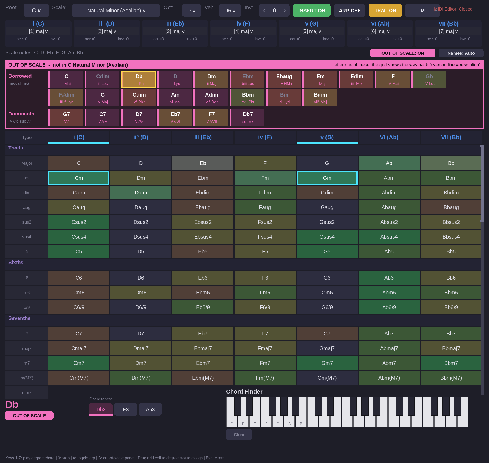

# Advanced ChordGun + Borrowed Chords

A fork of [del-paso/AdvancedChordGun](https://github.com/del-paso/AdvancedChordGun) that adds
out-of-scale chord suggestions. The fork's script is `AdvancedChordGun_Borrow.lua`; the
original `AdvancedChordGun.lua` is kept unchanged.

*(Preview rendered from the script's draw calls, not a REAPER screenshot.)*

## What this fork adds

- **OUT OF SCALE panel** above the grid, in its own magenta frame so it cannot be mistaken
  for the diatonic grid. Each button shows the chord, its numeral and where it is borrowed
  from (`bII Phr`, `IV Maj`, `V7/iv`, `subV7`):
  - **Borrowed** -- triads of the parallel scales (major, natural / harmonic / melodic minor,
    Dorian, Phrygian, Lydian, Mixolydian, Locrian) that the current scale does not have.
    Chords from rarely used sources (Lydian, Locrian) are dimmed.
  - **Dominants** -- secondary dominants (V7 of each major/minor degree) and the tritone
    substitute.
- The existing green/yellow/orange next-chord tint also applies to these buttons.
- **Way back** -- after an out-of-scale chord the grid is re-scored for resolution. The
  diatonic chords it resolves to get a cyan outline and the top tint, and their column
  headers a cyan underline. Playing a diatonic chord clears it.
- The chord name turns magenta with an **OUT OF SCALE** badge whenever the last chord has
  tones outside the scale, and those chord-tone buttons are marked.
- **Harmonic Minor** and **Melodic Minor** scales.
- **Flat note names** -- `Names: Auto / # / b` (Auto spells flat keys with flats).
- **B** toggles the panel.

### Install this fork with ReaPack

1. In REAPER, go to **Extensions → ReaPack → Import repositories...**
2. Paste this URL: `https://raw.githubusercontent.com/amenonegames/AdvancedChordGun/main/index.xml`
3. Go to **Extensions → ReaPack → Browse packages**, search "Borrowed", and install
   **Advanced ChordGun + Borrowed Chords**

It installs as a separate package and can stay installed next to the original. Both read
the same per-project settings.

---

Everything below is the original README.

# Advanced ChordGun

An expanded chord composition tool for REAPER, inspired by Pandabot's ChordGun.

## Installation

### Option 1: ReaPack (recommended)
1. In REAPER, go to **Extensions → ReaPack → Import repositories...**
2. Paste this URL: `https://raw.githubusercontent.com/del-paso/AdvancedChordGun/main/index.xml`
3. Go to **Extensions → ReaPack → Browse packages**, search "Advanced ChordGun", and click install

### Option 2: Manual install
1. Click `AdvancedChordGun.lua` in this repo
2. Click the **"Download raw file"** button (the download icon in the top-right of the file view) -- **don't right-click and "Save As" the page itself**
3. In REAPER, go to **Actions → Show action list → New action → Load ReaScript...**
4. Select the downloaded file

## Features

- **50+ chord types** -- triads, 6ths, 7ths, 9ths, 11ths, 13ths, altered dominants (7b9, 7#9, 7alt, 7b5b9, 7#5#9), half-diminished, m(maj7), maj7#5, and extended jazz voicings up to 10 notes
- **Full scrollable chord grid** showing every chord type on every scale degree at once, organized by category (Triads, Sixths, Sevenths, Ninths, Elevenths, Thirteenths, Altered Dominants, Extended Voicings)
- **Next-chord suggestion engine** -- after you play any chord, the grid lights up with green/yellow/orange tints showing which chords would sound good as the next move, based on shared pitch classes and root movement quality
- **Current chord highlight** -- whatever you just played lights up gold so you always know where you are on the grid
- **Trailing chord history** -- the previous 7 chords show fading gold borders behind the current one, so you can see your harmonic path through the grid as you sketch (toggleable)
- **Arpeggiate mode** -- plays chord notes one at a time instead of as a block chord, with adjustable delay (10-120ms), applies to both live preview and inserted MIDI
- **Round Robin humanize** -- randomizes per-note timing (40%-180% of base delay) and velocity for an organic, hand-played feel
- **Diatonic chord row auto-highlights** for whichever scale you're in
- **7 modes supported** -- Ionian, Dorian, Phrygian, Lydian, Mixolydian, Aeolian, Locrian, with Roman numeral degree headers updating per mode
- **Live MIDI preview** through whatever instrument you have armed
- **Insert mode** drops chords directly into the active MIDI editor at the cursor, advancing by grid size
- **Inversion control** (-4 to +4)
- **Dropdowns for all top controls** -- root, scale, octave, velocity
- **Clickable note buttons** for the played chord -- every note (even in 10-note voicings) appears as a clickable button to audition or insert individually
- **All settings persist with the project**

## New in v2.0

- **Per-degree octave offset and inversion** -- each of the 7 degree slots now has its own independent octave and inversion controls that stack on top of the global settings
- **Drag-to-assign** -- drag any chord from the grid directly to a degree slot at the top to assign it to that number key
- **Chord finder with 3-octave piano** -- click notes on the piano keyboard to toggle them on/off and the script identifies matching chords from the full 50+ chord dictionary. Each key highlights individually
- **Adjustable text size** -- S, M, L, XL with +/- controls for different screen sizes and resolutions
- **Window size and position persist** -- the window reopens exactly where you left it, at the size you last used
- **Trail/Arp button overlap fixed** -- trail toggle is now always visible regardless of arp state

## Keyboard Shortcuts

- `1-7` -- Play assigned chord for that scale degree
- `0` -- Stop all notes
- `A` -- Toggle arpeggiate
- `Up/Down` -- Scroll grid
- `Esc` -- Close

## License

MIT
